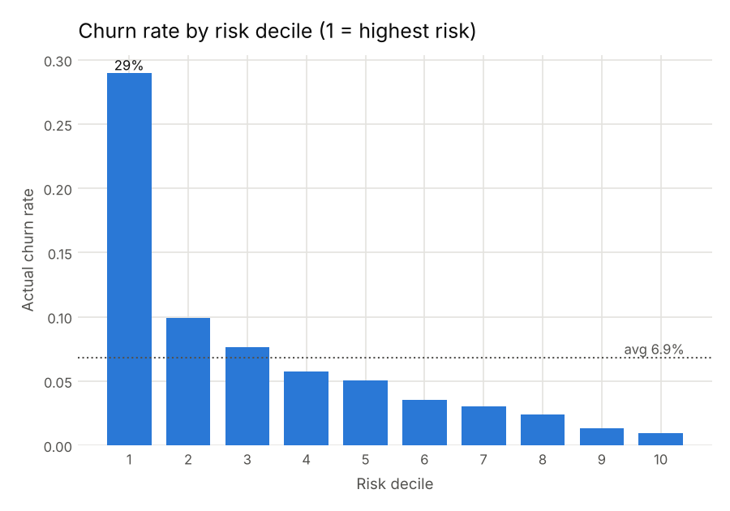
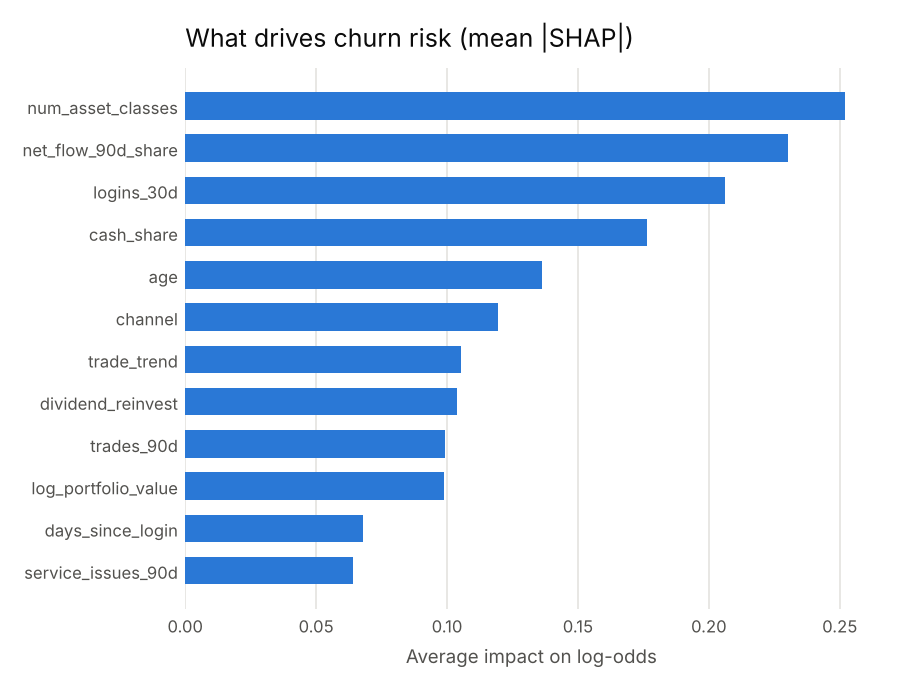
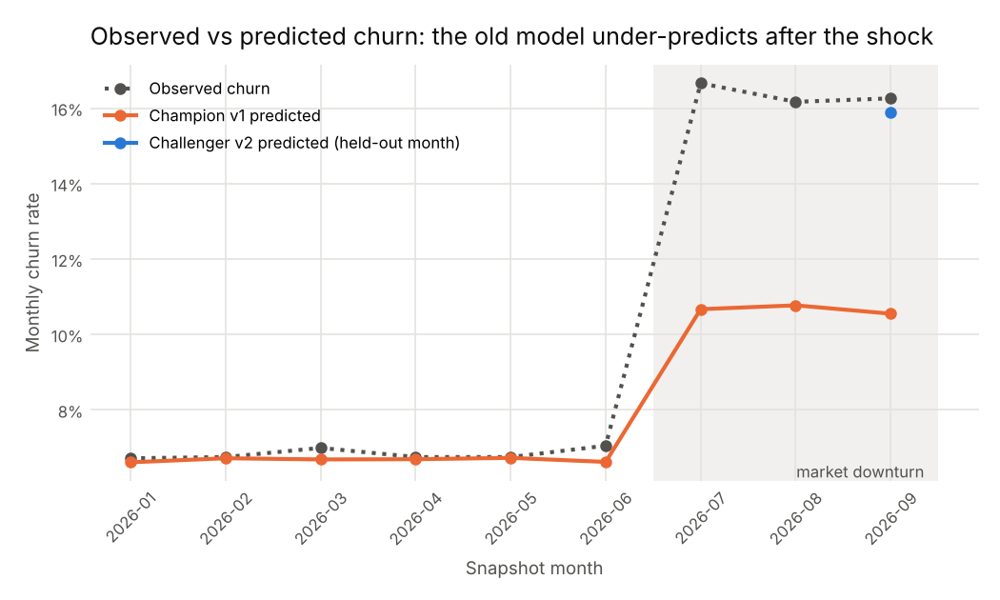
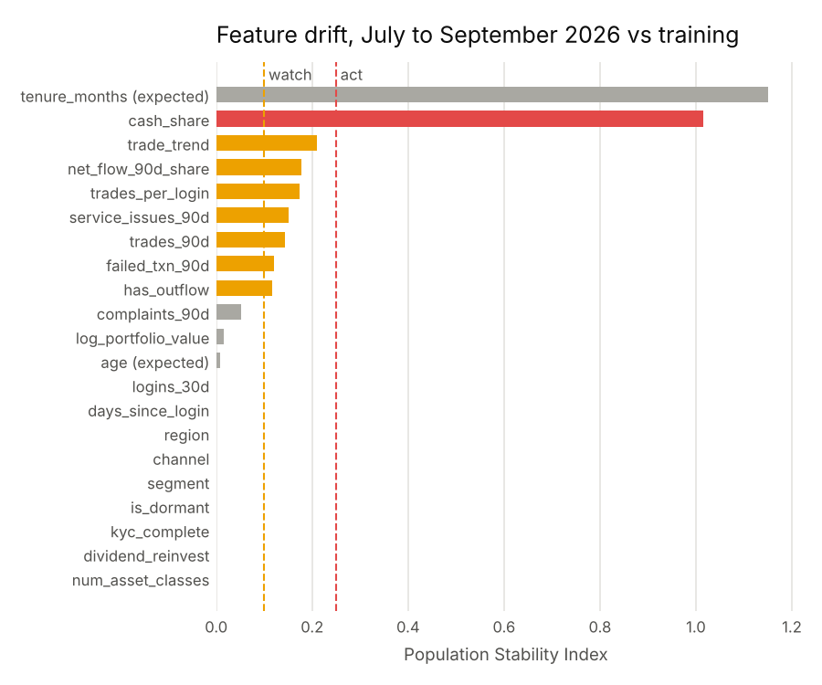
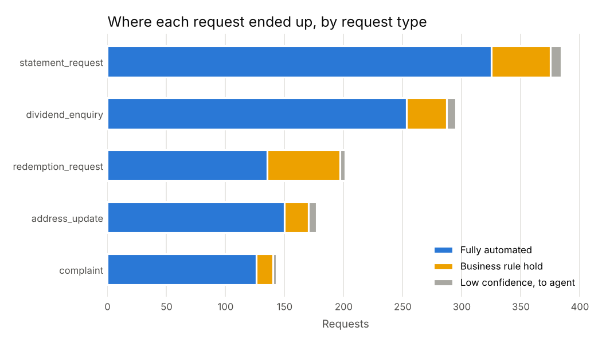

# ClientPulse

[](https://github.com/CodeKage25/clientpulse/actions/workflows/ci.yml)

Churn prediction, MLOps and intelligent automation for a brokerage and wealth management business, built end to end on synthetic data.

It covers the full cycle an AI engineer in a financial services data team owns: exploratory analysis and segmentation, a validated model, value-based targeting, a fairness review, a versioned registry mirrored to MLflow, drift monitoring, champion vs challenger retraining, a containerised scoring API, and an automation bot that combines RPA-style process handling with ML and reports the value it delivers.

All client data is generated. Nothing here touches real people or real accounts.

## What it shows

| Area | What is built | Where |
|---|---|---|
| EDA and segmentation | Shape of the book, churn signals, behavioural clusters with business actions | `notebooks/segmentation_eda.ipynb` |
| Churn model | LightGBM vs logistic baseline, time-based splits, PR-AUC, lift, calibration, SHAP | `clientpulse/model.py` |
| Business targeting | Contact clients by expected value in Naira, not by a fixed probability cut-off | `clientpulse/model.py` |
| Fairness review | Recall, false positives and calibration by segment, region, channel and age band | `clientpulse/fairness.py` |
| Model registry | Versions, lineage, promotion history; mirrored to MLflow with a `champion` alias | `clientpulse/registry.py`, `clientpulse/tracking.py` |
| Monitoring | PSI data drift, score drift, calibration and ranking decay, retrain triggers | `clientpulse/monitoring.py` |
| Retraining | Rolling window challenger, recency weighting, recalibration, held-out promotion gate | `clientpulse/pipeline.py` |
| Serving | FastAPI with input validation and per-client reason codes; Docker image; Render blueprint | `clientpulse/api.py`, `Dockerfile` |
| Intelligent automation | REFramework-style bot for a client service inbox, ML intent routing, controls, audit trail | `automation/` |
| Automation value | FTE released, turnaround, measured error rate, exception analysis | `automation/value.py` |
| CI | Tests, a full pipeline run and a container smoke test on every push | `.github/workflows/ci.yml` |

## Results from the last run

**Churn model (test window April to June 2026, 36,000 client-months, 6.9% churn)**

| Model | PR-AUC | ROC-AUC | Lift in top 10% | Recall in top 10% |
|---|---:|---:|---:|---:|
| Logistic baseline | 0.307 | 0.764 | 4.0x | 40% |
| LightGBM | 0.330 | 0.781 | 4.2x | 42% |

**Retention targeting, per month on the test window**

| Policy | Clients contacted | Expected net value |
|---|---:|---:|
| Contact everyone | 12,000 | minus N55.4m |
| Top 10% by churn probability | 1,200 | N3.5m |
| Expected-value targeting | 612 | N13.5m |

Half the calls, nearly four times the value, because it prioritises clients where the revenue at stake justifies the cost of the call.





**Fairness review before release**

No segment, region, channel or age band falls below 80% of overall recall or is miscalibrated by more than 3 points. Two things worth a human look: clients aged 60 plus get roughly double the false positive rate of younger groups (more unnecessary calls), and under-30s sit closest to the recall threshold. Full table in [reports/fairness.md](reports/fairness.md).

**Drift (July to September 2026, simulated market downturn)**

- Monitoring flagged cash share (PSI 1.02) and under-prediction: observed churn 16.4% vs 10.7% predicted.
- Ranking quality held (ROC-AUC 0.797), but calibration broke. That matters because targeting runs on predicted probabilities.
- Tenure also showed high PSI but is marked as expected drift, so it does not trigger a retrain on its own.

**Retraining: closing the calibration gap**

Four challengers were compared on September 2026, a month none of them saw:

| Variant | PR-AUC | Brier | Mean predicted (observed 16.3%) |
|---|---:|---:|---:|
| Champion v1, no retrain | 0.488 | 0.1145 | 10.5% |
| Rolling 12-month window | 0.518 | 0.1082 | 12.5% |
| + recency weighting | 0.524 | 0.1059 | 13.8% |
| + recalibration on latest month | 0.518 | 0.1058 | 15.9% |
| Recency weighting + recalibration (promoted as v2) | 0.524 | 0.1050 | 15.9% |

A plain retrain still under-predicts, because only one post-shock month is in its window. Weighting recent months improves ranking; recalibrating on the latest matured month fixes the level. Together they give the best of both. Details in [reports/retrain_ablation.md](reports/retrain_ablation.md).





**Client service bot (1,200 inbox requests)**

- 82% handled with no human touch; intent model accuracy 97.3%
- 2.7 FTE of capacity released (about 376 team hours a month at 2,500 requests)
- Error rate on automated items 0.4% measured, against 2.5% assumed for manual handling
- Every exception reaches a person with a reason attached: missing account number, sender does not own the account, redemption over balance, low classifier confidence



## Run it

```bash
pip install -r requirements.txt

python -m clientpulse.pipeline   # data, train, fairness, register, monitor, retrain, score
python -m automation.run         # bot over the inbox, value report
pytest -q                        # 22 tests

uvicorn clientpulse.api:app --reload   # then open http://127.0.0.1:8000/docs
mlflow ui --backend-store-uri sqlite:///mlflow.db   # runs, registered versions, champion alias
```

Or `make all`.

### Docker and deployment

```bash
docker build -t clientpulse-api .
docker run -p 8000:8000 clientpulse-api
```

The image installs only what serving needs and runs as a non-root user. To deploy on Render, create a new Blueprint from this repo; `render.yaml` sets up the service with a health check.

## Outputs

```
reports/
  pr_curve.png, calibration.png, lift_by_decile.png, shap_importance.png
  drift_psi.png, observed_vs_predicted.png
  fairness.md                   group error analysis at the operating point
  monitoring_report.md          what drifted, what decayed, the decision
  retrain_ablation.md           which retraining fix closed the gap
  retention_list_2026-09.csv    top 500 clients for relationship managers, with reasons
  automation/
    value_report.md             FTE, turnaround, error rate, exception reasons
    bot_run_log.csv             one row per request, with status and reason
    human_work_queue.csv        what people need to pick up
    audit_trail.csv             every action the bot took
models/
  registry.json                 versions, stages, promotion history, MLflow version links
  v1/, v2/                      model plus metadata (lineage, metrics, drift reference)
notebooks/
  segmentation_eda.ipynb        EDA and behavioural segmentation
```

## Docs

- [Model card](docs/MODEL_CARD.md): purpose, data, metrics, fairness, limits, assumptions
- [Automation design](docs/AUTOMATION_DESIGN.md): process definition and solution design for the bot
- [Building it in UiPath or Power Automate](docs/RPA_PLATFORM_GUIDE.md): how the same bot maps onto enterprise RPA platforms

## Honest limits

- Synthetic data. The patterns are designed to be realistic, not measured from a real book of clients.
- The intent classifier is trained on generated tickets, so 97% is optimistic. Real tickets would be messier.
- The file registry drives promotion so the repo runs anywhere; MLflow mirrors it. In production MLflow (or a managed registry) would be the single source of truth.
- The bot logic is written in Python. On an enterprise RPA platform the same design maps onto queues, REFramework states and activities (see the platform guide).
